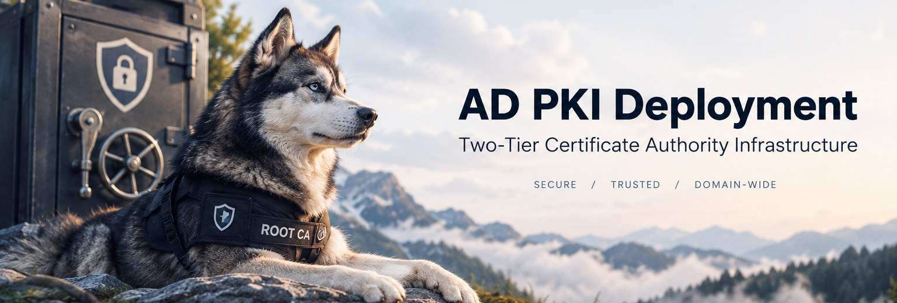
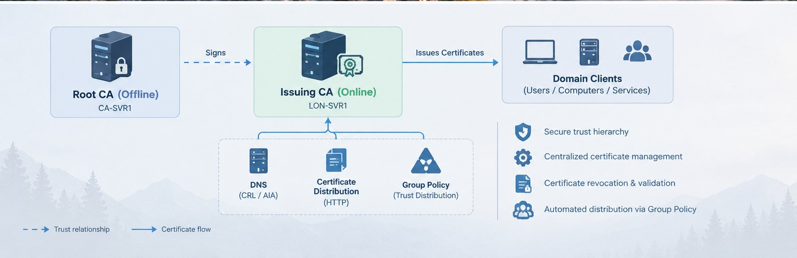
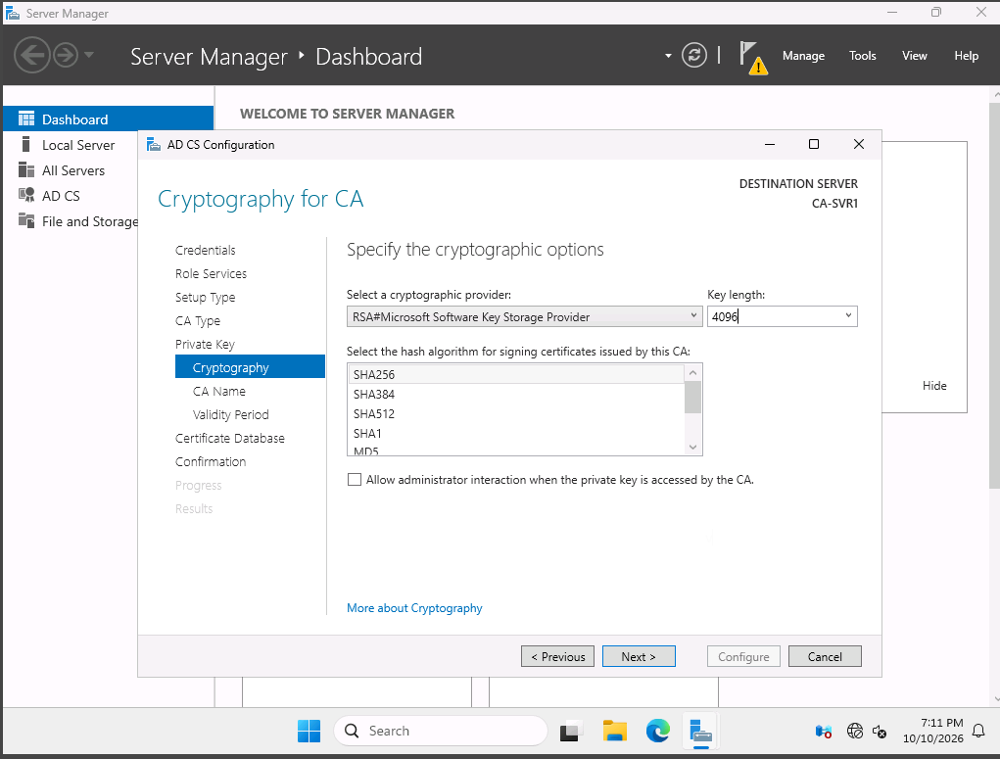
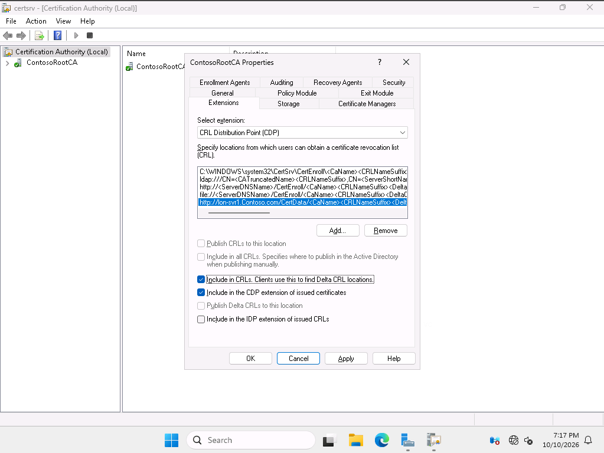
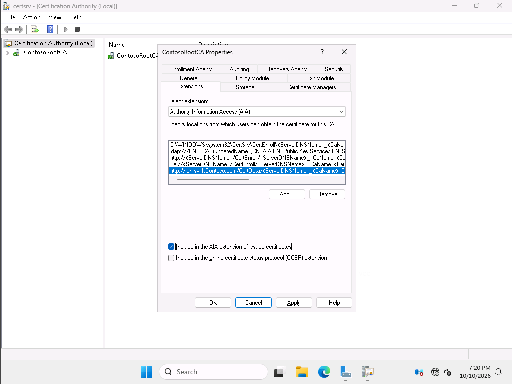
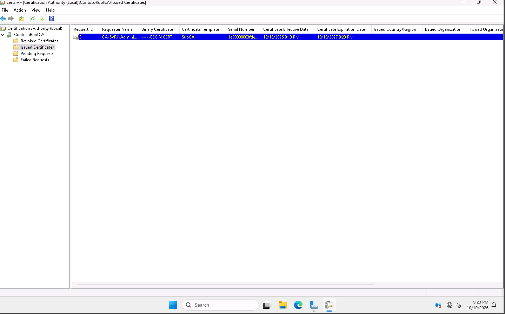
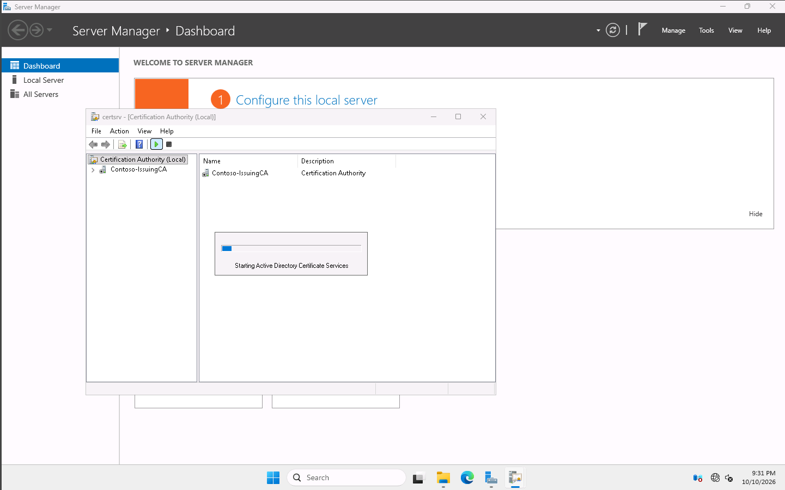
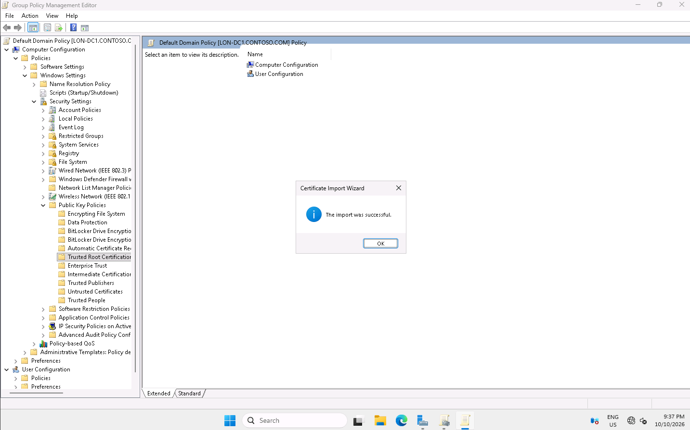

# AD PKI Deployment

**Two-Tier Certificate Authority Infrastructure**  
Microsoft Software & Systems Academy (MSSA) — Server and Cloud Administration

## Project Overview

I deployed a two-tier Public Key Infrastructure (PKI) using Windows Server and Active Directory Certificate Services (AD CS) in a simulated Contoso environment. The goal was to support centralized certificate management while keeping the most sensitive certificate authority offline.

### Business Scenario

As more internal services use certificates, managing trust and revocation by hand becomes difficult. Contoso needed an issuing CA for regular certificate operations without leaving the Root CA and its private key exposed all the time.

Without centralized management, certificate issuance and trust settings could become inconsistent. The Root CA's private key also presents a security risk: if it were compromised, certificates trusted under that root could be affected.

My approach was to configure a **standalone offline Root CA**, have it sign an **Active Directory-integrated subordinate CA**, and use Group Policy to configure Root CA trust distribution. I also configured locations for clients to find certificate and revocation information.

**Technologies:** Windows Server 2025, AD CS, Active Directory, Group Policy, DNS, HTTP certificate distribution, RSA, SHA256

---

## Infrastructure

| System | Role |
|---|---|
| `CA-SVR1` / `ContosoRootCA` | Standalone Root CA, taken offline after setup |
| `LON-SVR1` / `Contoso-IssuingCA` | Enterprise subordinate CA and HTTP certificate distribution host |
| `LON-DC1` | Active Directory, DNS, and Group Policy |
| `contoso.com` | Lab domain |

*The illustration explains the design. The screenshots below show the actual lab configuration; client certificate validation was not independently tested.*

---

## 1. Configure the Offline Root CA

I installed AD CS on `CA-SVR1` and configured a **Standalone Root CA** named `ContosoRootCA`.

| Setting | Value |
|---|---|
| Cryptographic provider | Microsoft Software Key Storage Provider |
| Key algorithm and length | RSA, 4096-bit |
| Signing hash | SHA256 |

I used a standalone CA because the Root CA did not need Active Directory integration for everyday certificate issuance. Its RSA 4096 key and SHA256 signing configuration matter because the subordinate CA receives its certificate from this trust anchor.

The Root CA is the trust anchor for the hierarchy. Its private key signs the subordinate CA certificate, so I set up the issuing tier separately rather than using the Root CA for everyday certificate requests.

## 2. Configure CDP and AIA

I configured two extensions on `ContosoRootCA`, both using an HTTP location under `http://lon-svr1.contoso.com/CertData/`:

- **CDP (CRL Distribution Point):** Tells clients where to find certificate revocation information.
- **AIA (Authority Information Access):** Helps clients locate issuing CA certificates when building a trust chain.

CDP and AIA address separate parts of validation. A certificate might be revoked before it expires, and a client needs information about that status. Building a certificate chain can also require locating the certificate of the issuing CA.

*CDP settings include the configured HTTP distribution location and certificate/CRL options.*

*The AIA location was configured for inclusion in issued certificates.*

I published the Root CA's CRL and exported its public certificate for distribution through `LON-SVR1`. These public files can be made available to other systems without exposing the Root CA's private key.

These locations help clients obtain validation information without contacting the offline Root CA. The configuration was captured, but I did not record a separate test of HTTP accessibility.

## 3. Deploy and Sign the Subordinate CA

Next, I installed AD CS on `LON-SVR1` and configured an **Enterprise Subordinate CA** named `Contoso-IssuingCA`.

Unlike the standalone Root CA, an Enterprise CA integrates with Active Directory for certificate services within the domain. Before it could operate under the root's authority, its certificate request had to be approved and signed by `ContosoRootCA`.

I imported `RootCA.cer` into the server's trusted root store, prepared the public certificate and CRL files under `C:\inetpub\wwwroot\CertData`, and generated a subordinate CA certificate request. I then submitted it to `ContosoRootCA` for approval.

The Root CA issued the request as **Request ID 3**, using the **SubCA** template. This is the step that connects the issuing CA to the Root CA's trust hierarchy.

The actual request ID differed from the lab example, so I checked the request itself instead of relying on the number. Once signed, the subordinate CA had a certificate linking it to the Root CA rather than forming a separate trust hierarchy.

## 4. Start the Issuing CA and Secure the Root

I exported the signed subordinate certificate as `SubCA.p7b`, installed it on `LON-SVR1`, and started Active Directory Certificate Services.

*The screenshot shows service startup in progress. The process later completed without a reported error; I did not capture a separate running-service screenshot.*

After the subordinate CA was configured, I **shut down `CA-SVR1`**. The issuing CA remained available for regular certificate operations, while the Root CA would only need to be brought online for authorized maintenance.

## 5. Distribute Root CA Trust with Group Policy

Domain computers also need to trust the Root CA. Rather than import its certificate on each machine separately, I configured the **Default Domain Policy** on `LON-DC1`:

`Computer Configuration → Policies → Windows Settings → Security Settings → Public Key Policies → Trusted Root Certification Authorities`

I imported `RootCA.cer` into that policy.

The Certificate Import Wizard reported **“The import was successful.”** This confirms the policy configuration step, not that trust was applied and validated on a separate client.

A successful GPO import is different from proving that a workstation received the certificate. In a production deployment, I would refresh policy on a representative client, inspect its trusted root store, and validate the certificate chain.

---

## Troubleshooting

Three issues came up during the deployment:

| Issue | What I did / learned |
|---|---|
| **Web Enrollment was unavailable** | Checked AD CS role services and found the optional Web Enrollment component missing. Addressed the missing role service separately. |
| **Administrative share access failed** | A connection problem interrupted access to `\\LON-SVR1\C$`. The workflow later continued, but the exact cause was not established. |
| **Request ID differed from the lab instructions** | The instructions referenced ID 2; my environment used ID 3. I verified the actual subordinate request rather than relying on the example ID. |

The main lesson was that certificate deployment also depends on basic Windows infrastructure: role services, DNS, file access, and careful verification.

The temporary share-access problem showed that supporting infrastructure can interrupt the deployment even when certificate settings are correct. The request ID mismatch was another reminder to check the actual environment rather than blindly follow the lab instructions.

## Results and Impact

| Component | Observed result |
|---|---|
| Offline Root CA | RSA 4096/SHA256 configuration captured |
| CDP and AIA | HTTP extension settings configured |
| Subordinate CA | Certificate issued by `ContosoRootCA` |
| Issuing CA | Service startup completed without a reported error |
| Root CA exposure | `CA-SVR1` shut down after configuration |
| Group Policy trust | Root certificate import succeeded |

The lab established the core components of a **two-tier Windows PKI**. The design separates the protected Root CA from regular issuance work and provides a centralized way to configure certificate trust in Active Directory.

**Practical value:** Keeping the Root CA offline limits routine exposure of its private key. The issuing CA can support normal certificate operations, Group Policy provides centralized trust distribution, and CDP/AIA settings provide locations for certificate-chain and revocation information.

**Validation limits:** I did not capture independent tests of the HTTP CDP/AIA endpoints or certificate trust on a domain client. Those would be the next checks in a production deployment.

## What I Took Away

Before this lab, I understood certificates mainly as something services use for trust and encryption. This project helped me understand the infrastructure behind them: how a Root CA signs an issuing CA, why the Root CA is kept offline, and how Group Policy and certificate distribution locations support the environment.

I also learned that issuing a certificate is only one part of PKI deployment. Trust distribution and client-side validation need their own checks before an environment can be considered ready for production.

**Skills practiced:** Windows Server · AD CS · Two-tier PKI · Certificate Trust · RSA/SHA256 · CDP/CRL · AIA · Group Policy · Infrastructure Troubleshooting